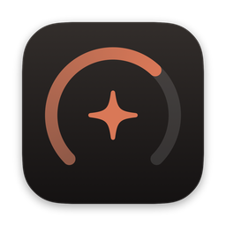
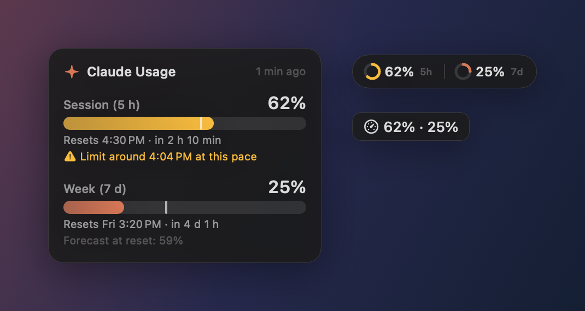

<p align="center"></p>

<h1 align="center">Claude Usage</h1>

<p align="center">
Your Claude Code limits, always in sight.<br>
A tiny native macOS widget for the 5-hour session and the weekly limit, floating above your work and in the menu bar.
</p>

<p align="center"></p>

## Features

- **Always on top:** a small glass panel that stays above all apps and on every Space. Drag it anywhere, double-click to switch between the card and a compact pill, right-click for the menu.
- **Menu bar:** a gauge icon with both percentages. Click it for the details and the settings (floating panel, menu bar text, launch at login).
- **Pace tick:** the mark on each bar shows how much of the window has passed. If the fill is right of the tick, you are burning faster than an even pace.
- **Forecast:** extrapolates your average rate so far to the reset. When you are on track to hit 100 % early, the row turns amber and tells you when ("Limit around 4:04 PM at this pace"). At 90 % it turns red.
- **Custom row (optional):** one extra line fed by your own script, e.g. hours tracked today or a build status.
- **Native and small:** SwiftUI and AppKit, no dependencies, no Xcode project. English and German, and it follows your system's 12/24-hour setting.

## Install

**Download:** grab `ClaudeUsage.zip` from the [latest release](../../releases/latest), unzip it and move `Claude Usage.app` to Applications.
The app is not notarized. On first launch, macOS blocks it. Open **System Settings → Privacy & Security** and click **Open Anyway**, or run:

```bash
xattr -dr com.apple.quarantine "/Applications/Claude Usage.app"
```

**Build from source:** needs Xcode 16 or later.

```bash
git clone https://github.com/alohacyclist/claude-usage-widget.git && cd claude-usage-widget && ./build.sh --install
```

`--install` copies the app to `~/Applications` and starts it. Turn on **Launch at login** in the menu bar popover.

## Requirements

- macOS 15 Sequoia or later
- [Claude Code](https://github.com/anthropics/claude-code) signed in with a Claude subscription (Pro or Max). The 5-hour and weekly limits belong to those plans, so an API-key login has nothing to show.

## How it works

Claude Code stores its OAuth login in the macOS keychain (`Claude Code-credentials`). The widget reads the access token from there and asks `GET https://api.anthropic.com/api/oauth/usage` for the current utilization of both windows.

- It polls every 2 minutes, after wake, and when you open the menu. On HTTP 429 it backs off (2, 4, 8 … up to 60 minutes) or follows `Retry-After`.
- It **only reads** the token and never refreshes it. Refreshing would rotate the refresh token and sign Claude Code out. If the token has expired, open Claude Code once and the widget picks up the new one.
- The token goes to `api.anthropic.com` and nowhere else. No analytics, no other network calls. Settings live in `UserDefaults`.
- If macOS asks whether `security` may read the keychain item, choose **Always Allow**.

## Custom row

Point the widget at a shell command. It runs with `/bin/zsh -c` at launch, every hour, after wake, when you open the menu (if older than 5 minutes) and on **Refresh**. The last non-empty line of its output must be a JSON object:

```json
{"title": "Today", "value": "4:05h", "detail": "2 sessions active", "active": true}
```

`detail` and `active` are optional; `active` adds a green or gray dot. On a non-zero exit, a timeout (30 s) or other output, the row keeps the last value and shows the error.

```bash
defaults write de.christianm.claude-usage customRowCommand '/path/to/your/status-script'
```

```bash
defaults write de.christianm.claude-usage customRowInterval -float 900
```

The interval is in seconds (default 3600, minimum 60). Restart the app after changing either value; `defaults delete de.christianm.claude-usage customRowCommand` removes the row. The command runs without your login shell setup, so use absolute paths. If it reads files in Desktop or Documents, macOS asks once for access.

## Development

```bash
swift test
```

```bash
./build.sh
```

- `swift test` runs the forecast, decoding, backoff and command row tests. `Package.swift` exists only for the tests; `build.sh` compiles the app with plain `swiftc` into a universal `build/Claude Usage.app`.
- `swift scripts/make-icon.swift` redraws `Resources/AppIcon.icns`. `scripts/screenshot.swift` renders the README screenshot from sample data.
- Strings: English is the source language; German lives in `Resources/de.lproj/Localizable.strings`.

## Disclaimer

This is an unofficial project, not affiliated with or endorsed by Anthropic. It relies on an undocumented endpoint that can change or disappear at any time.

## License

[MIT](LICENSE) © Christian Mueller
